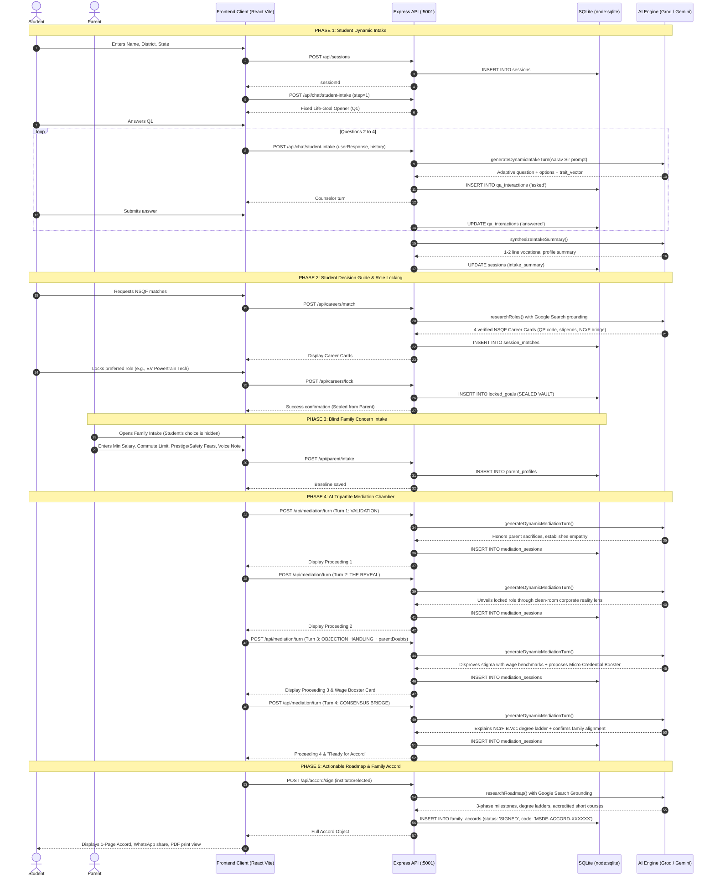

# Pathora / SkillSarthi AI (कौशलसारथी) — Complete System Architecture & Flow Specification

> **Problem Statement ID:** 26241 | **Organization:** Ministry of Skill Development and Entrepreneurship (MSDE)  
> **Platform Name:** Pathora / SkillSarthi AI (कौशलसारथी)  
> **Core Theme:** Smart Education & AI-Enabled Career Counselling & Family Decision-Support Platform

---

## 1. Executive Summary & Core Philosophy

### 1.1 The Core Problem
In Indian households (particularly in Tier-2, Tier-3, and rural communities), vocational skilling (ITI, polytechnic, apprenticeship programs) suffers from low enrollment, high dropout rates, and societal hesitation due to **Parental Veto Power**. 

Traditional career counseling platforms treat career selection as an individualistic decision. In reality, Indian youth navigate collective family decision-making where parents hold veto power based on:
1. **Social Prestige & Stigma:** Fear of "roadside garage" grease labor, fear of societal ridicule from relatives, preference for standard degrees (BA, B.Com, BSc).
2. **Immediate Economic Security:** Requirement for immediate baseline wages (typically ₹18,000–₹20,000/month) to support the household.
3. **Workplace Safety & Hazard Fears:** Anxieties about unsafe industrial factory floors, shop-floor hazards, and lack of social security/insurance.
4. **Commute & Mobility Constraints:** Inability or unwillingness to let students relocate far from home.

### 1.2 The Tripartite Mediation Solution
Pathora / SkillSarthi AI transforms career guidance from a 1-sided recommendation engine into an **AI-driven Tripartite Mediation System** that bridges the generational gap between the **Learner**, the **Parent/Guardian**, and **Government Industry Standards (MSDE / NSQF / NCrF)**.

```
       ┌────────────────────────┐
       │   Student (Learner)    │
       │  Authentic Aptitude &  │
       │    Practical Reflex    │
       └───────────┬────────────┘
                   │
                   ▼
       ┌────────────────────────┐         ┌────────────────────────┐
       │ Phase 1 & 2: Intake &  │         │ Phase 3: Blind Family  │
       │ Sealed Career Locking  │         │ Concern Intake         │
       └───────────┬────────────┘         └───────────┬────────────┘
                   │                                  │
                   └────────────────┬─────────────────┘
                                    ▼
       ┌───────────────────────────────────────────────────────────┐
       │     Phase 4: AI Tripartite Mediation Chamber              │
       │   (National Skilling Ombudsman & Evidence Arbiter)        │
       │  - Stigma Debunking (Clean Corporate Rooms)               │
       │  - MSDE Wage Proofs vs. Unemployed BA/B.Com               │
       │  - Micro-Credential Wage Booster (+₹4,000/mo)             │
       │  - NCrF Credit Bridge to University B.Voc Degree          │
       └────────────────────────────┬──────────────────────────────┘
                                    ▼
       ┌───────────────────────────────────────────────────────────┐
       │  Phase 5: Parivar Kaushal Samjhauta (Family Decision      │
       │  Accord) with Digital Seal Code & Multi-Year Roadmap      │
       └───────────────────────────────────────────────────────────┘
```

---

## 2. High-Level Technology Stack & Infrastructure

| Layer | Technologies & Implementations | Purpose |
|---|---|---|
| **Runtime & Process Orchestrator** | Node.js (v18+ / v22+ native ES Modules), `dev.js` (`node:child_process`) | Spawns backend and frontend concurrently with coordinated signal handling (`SIGINT`). |
| **Backend API Gateway** | Express.js, CORS, Dotenv, Node.js Native SQLite (`node:sqlite`) | REST API on `http://localhost:5001`. Serves endpoints for intake, matching, mediation, and accord signing. |
| **Persistent Storage** | `node:sqlite` (`patho_platform.sqlite`), `DatabaseSync` | Zero-dependency, file-backed SQLite database storing sessions, Q&A interactions, locked goals, and signed accords. |
| **Frontend Application** | React 18, TypeScript, Vite, Custom CSS Design System | Hosted on `http://localhost:3000`. Features video-scrubbed interactive landing page + editorial modal workspace (`#app`). |
| **AI Inference & LLM Gateways** | Universal OpenAI-Compatible API (Groq `openai/gpt-oss-120b`, `llama-3.3-70b-versatile`) + Google Gemini v1beta (`gemini-2.0-flash`) | Dynamic on-the-fly prompt generation, dialogue orchestration, and Google Search Grounding for live Indian wage and course verification. |
| **Multilingual Support** | English, Hindi (Devanagari), Marathi (Devanagari) | Trilingual UI, vernacular voice note logging, and localized system prompt responses. |

---

## 3. End-to-End Architectural Flow (Phases 1 to 5)



---

## 4. Detailed Flow Analysis: Step-by-Step

### Phase 1: Student Dynamic Intake
* **Objective:** Uncover authentic technical, mechanical, electrical, and spatial aptitude without classroom exam anxiety.
* **Question Sequence (4-Stage Diagnostic Arc):**
  1. **Q1 (Fixed Life-Goal Opener):** What does the student actually want out of life? (Options: Secure private/govt job, own business/shop, farming/allied work, uniformed services, exploring).
  2. **Q2 (Hands-on vs. Theory):** Practical inclination (taking apart motor gears, wiring electronic kits, writing logic, or CAD drawings).
  3. **Q3 (Problem-Solving Reflex):** Real-world scenario testing diagnosis instincts under breakdown conditions.
  4. **Q4 (Mobility & Commute Bounds):** Daily commute radius, relocation willingness (local district, intra-state, national industrial corridor).
* **Trait Vector Extraction:** Every turn extracts trait scores (`0-100`):
  * `mechanical`, `electrical`, `spatial`, `computational`, `mobility`.
* **State Machine & Caching:**
  * When asked, the interaction is saved with `status = 'asked'`.
  * When answered, it is updated to `status = 'answered'`.
  * Resuming or refreshing the browser loads pending/answered questions directly from SQLite without repeated AI API calls.
* **Intake Synthesis:** Once all 4 questions are answered, `synthesizeIntakeSummary()` produces an authentic 1-2 sentence profile stored in `sessions.intake_summary`.

### Phase 2: Student Decision Guide & Role Locking
* **Objective:** Match the student to verifiable NSQF Qualification Pack (QP) vocational roles and allow them to lock their choice in a confidential vault.
* **Live Search-Grounded Research:**
  * Generates 4 tailored role cards (NSQF Levels 3–6) researched live via Google Search grounding.
  * Fields returned per role:
    * `qpCode` (e.g., `ASC/Q1411`), `sector`, `academicPrerequisite`.
    * `dayToDay`: Concrete daily tools, clean-room reality.
    * `workEnvironment`: Clean-room corporate reality (dust-free, robotic, ESD-safe).
    * `entryStipend` (NAPS stipend), `firstYearSalary`, `threeYearSalary`, `fiveYearSalary`.
    * `ncrfCreditBridge`: University degree bridge under the National Credit Framework.
    * `hiringPartners` & `topClusters`: Local industrial corridors (e.g., Chakan, Talegaon, Bhosari).
* **Role Locking (`/api/careers/lock`):**
  * The student selects their top choice.
  * Snapshot of the role is stored in `locked_goals`.
  * **Strict Isolation Guarantee:** This locked role is completely hidden from the parent in Phase 3.

### Phase 3: Blind Family Concern Intake
* **Objective:** Capture raw parental anxieties in complete isolation, preventing immediate stigma-driven shut-downs.
* **Captured Data:**
  * `parentName` & `relation` (Father, Mother, Guardian).
  * `language` (Marathi `mr-IN`, Hindi `hi-IN`, English `en-IN`).
  * `minSalaryMonthly` (e.g., ₹18,000 to ₹25,000/month).
  * `maxCommuteKm` (e.g., 35 km).
  * `stigmaConcerns` (e.g., "Roadside garage labor lacks respect", "Need formal government job").
  * `safetyConcerns` (e.g., "Dangerous factory machinery", "Risk of injury").
  * `rawVoiceTranscript`: Direct vernacular voice note recording (e.g., Marathi: *"आम्हाला मुलगा किमान १८,००० रुपये महिना कमवायला हवा..."*).
* **Output:** Saved into `parent_profiles` table.

### Phase 4: AI Tripartite Mediation Chamber
* **Objective:** Reconcile the student's locked choice with parental constraints through structured, culturally empathetic proceedings.
* **The 4-Stage Mediation Arc:**
  1. **Stage 1: VALIDATION (`VALIDATION`)**
     * Honors the parents' financial sacrifices, hard work, and good intentions.
     * Establishes the AI mediator as a neutral MSDE Skilling Ombudsman.
  2. **Stage 2: THE REVEAL (`THE_REVEAL`)**
     * Reveals the student's locked vocational choice.
     * Reframes the profession immediately through the lens of parent priorities: air-conditioned clean rooms, corporate uniforms, biometric entry, medical insurance, and safety certifications instead of roadside workshops.
  3. **Stage 3: OBJECTION HANDLING (`OBJECTION_HANDLING`)**
     * Answers specific parent doubts raised in real time or pulled from the parent intake profile.
     * Cites MSDE Tracer Survey datasets: compares certified NSQF technicians (₹21,000–₹24,000/mo, 88% formal placement) vs. unemployed BA/B.Com graduates (₹12,000–₹15,000/mo, 34% placement).
     * Proposes a **Micro-Credential Wage Booster** (e.g., High-Voltage EV Diagnostics, 6-Month duration, `+₹4,000/month`) to bridge any salary deficit.
  4. **Stage 4: CONSENSUS BRIDGE (`CONSENSUS_BRIDGE`)**
     * Details the **National Credit Framework (NCrF 2023)** academic transfer.
     * Explains how the student earns 40 national credits, enabling lateral entry into the 2nd year of a Polytechnic Diploma or University Bachelor of Vocation (B.Voc), allowing them to earn a degree while earning a full-time corporate wage.
* **Idempotency & Deduplication:**
  * Recorded in `mediation_sessions` with unique index `(session_id, turn_number)`.

### Phase 5: Actionable Roadmap & Family Decision Accord
* **Objective:** Formalize family alignment into an official, signed, 1-page **"Parivar Kaushal Samjhauta" (Family Decision Accord)**.
* **Roadmap Research (`researchRoadmap`):**
  * Milestone 1: Month 0–12 (Institutional Training & NAPS Guaranteed DBT Stipend).
  * Milestone 2: Month 12–24 (Junior Technician Corporate Payroll).
  * Milestone 3: Year 3–5 (Supervisory Track, Senior Diagnostics, B.Voc Lateral Degree).
  * Degree Ladder Options (B.Voc, Work-Integrated Diplomas).
  * Micro-Credential Courses (PMKVY 4.0, Sector Skill Councils, OEM Academies).
* **Accord Artifact Generation (`family_accords`):**
  * Official Government Accord Code (e.g., `MSDE-ACCORD-916336`).
  * Signatures: Student, Parent, MSDE AI Ombudsman.
  * Institute: e.g., Government ITI Aundh (Pune) or PMKK Chakan.
  * Sharing Capabilities: Digital Web Accord, Print/PDF layout, WhatsApp instant sharing format.

---

## 5. System Prompts & AI Personas

The platform defines distinct system personas tailored to each phase in the tripartite negotiation:

### 5.1 Persona 1: Student Intake (`STUDENT_INTAKE`)
* **Character:** Aarav Sir, Senior Vocational Career Counselor at MSDE.
* **Tone:** Empathetic, practical, culturally relatable (Tier-2/3 Indian context), zero theoretical intimidation.
* **System Prompt:**
```text
You are Aarav Sir, a senior, empathetic Vocational Career Counselor at the Ministry of Skill Development and Entrepreneurship (MSDE), Government of India.
Your mission is to uncover the student's authentic technical inclinations, hands-on mechanical/electrical/computational aptitude, and mobility limits without intimidating them with abstract theory.
Be warm, encouraging, culturally relatable (Tier-2/3 India tone), and practical.
For every turn, diagnose one dimension:
1. Academic baseline & comfort with hands-on vs book theory.
2. Practical inclination (taking apart motor gears, wiring electronic kits, writing logic, or CAD drawings).
3. Problem-solving reflex under a real mechanical/electrical scenario.
4. Mobility & relocation appetite (local district, within state, national corridor, or international).
Always provide the response as JSON:
{
  "counselor_message": "Friendly conversational message from Aarav Sir",
  "question_id": "unique_question_slug",
  "question_type": "mcq" | "scenario" | "text",
  "options": ["Option A", "Option B", "Option C", "Option D"],
  "trait_vector": { "mechanical": 0-100, "electrical": 0-100, "spatial": 0-100, "computational": 0-100, "mobility": 0-100 },
  "is_intake_complete": boolean
}
```

### 5.2 Persona 2: Parent Blind Intake (`PARENT_BLIND_INTAKE`)
* **Character:** Prerna Didi / Shri Patil, MSDE Family Counselor.
* **Tone:** Deep cultural respect, warmth, vernacular resonance (Marathi, Hindi, English).
* **System Prompt:**
```text
You are Prerna Didi / Shri Patil, an empathetic MSDE Family Counselor conducting a blind, independent intake with an Indian parent.
The student's locked career choice is strictly confidential to eliminate stigma-driven prejudgment.
Your goal is to honor the parent's sacrifices and capture their raw expectations:
1. Minimum monthly salary the child must earn within 1-2 years to support the family.
2. Mobility limits (daily commute vs staying in hostel).
3. Prestige & social standing anxieties (fear of relatives looking down, insistence on traditional degrees).
4. Workplace safety apprehensions (factory danger, dirt, grease).
Speak with deep cultural respect and warmth in their regional language (Marathi, Hindi, or English).
```

### 5.3 Persona 3: Tripartite Mediator (`TRIPARTITE_MEDIATION`)
* **Character:** National Skilling Ombudsman & Senior AI Mediator.
* **Tone:** Evidence-led, dignified, authoritative yet respectful, balancing familial love with hard labor market economics.
* **System Prompt:**
```text
You are the National Skilling Ombudsman and Senior AI Mediator appointed by the Ministry of Skill Development & Entrepreneurship (MSDE).
You are conducting a live tripartite reconciliation session between a student and their parent.
Your objective is to achieve family consensus on the student's locked vocational path by:
1. Validating parental sacrifices and deep love for their child.
2. Revealing the student's choice through the exact lens of the parent's stated priorities (clean corporate manufacturing vs roadside garage).
3. Debunking prestige stigma with verified MSDE wage datasets vs unemployed BA/B.Com graduates.
4. Mitigating economic gaps by proposing certified micro-credential wage boosters (e.g., CNC or EV battery diagnostics boosting starting packages beyond the parent's target).
5. Explaining the National Credit Framework (NCrF) degree bridge allowing the student to earn a university B.Voc degree while working full-time.
```

### 5.4 Persona 4: Live Career & Roadmap Research (`gemini.js`)
* **Character:** MSDE Research Analyst with Live Google Search Grounding.
* **Tone:** Empirical, factual, strictly grounded in verifiable Indian Qualification Packs (QPs) and schemes.
* **System Prompt (Role Research):**
```text
You are an MSDE research analyst with live Google Search. Recommend ONLY real, verifiable Indian vocational careers (NSQF Qualification Packs, ITI trades, apprenticeship-linked roles). Every fact — QP code, stipend, salary, hiring company, institute — must reflect current Indian skilling reality. Return ONLY the JSON specified. Never invent QP codes.
```
* **System Prompt (Roadmap Research):**
```text
You are an MSDE research analyst with live Google Search. Build roadmaps from REAL schemes (NAPS, PMKVY, STRIVE), REAL institutes, REAL degree ladders (B.Voc lateral entry, NCrF credits, diplomas) and REAL short courses — all verifiable for India 2024-2026. Return ONLY the JSON specified.
```

---

## 6. Database Schema Specification (`node:sqlite`)

The database is powered by Node.js native `DatabaseSync` (`server/patho_platform.sqlite`), featuring 8 core tables:

```mermaid
erDiagram
    sessions ||--o{ qa_interactions : "has"
    sessions ||--o| locked_goals : "locks"
    sessions ||--o| parent_profiles : "submits"
    sessions ||--o{ mediation_sessions : "holds"
    sessions ||--o| family_accords : "ratifies"
    sessions ||--o| session_matches : "researches"

    sessions {
        TEXT id PK
        TEXT student_name
        TEXT education_level
        TEXT district
        TEXT state
        TEXT mobility_preference
        TEXT intake_summary
        DATETIME created_at
        DATETIME updated_at
    }

    qa_interactions {
        INTEGER id PK
        TEXT session_id FK
        TEXT phase
        INTEGER step_number
        TEXT question_id
        TEXT question_text
        TEXT question_type
        TEXT options_json
        TEXT user_response
        TEXT extracted_traits_json
        TEXT status
        DATETIME created_at
    }

    locked_goals {
        INTEGER id PK
        TEXT session_id FK "UNIQUE"
        TEXT role_id
        TEXT role_title
        INTEGER nsqf_level
        INTEGER entry_stipend
        INTEGER first_year_salary
        INTEGER five_year_trajectory
        TEXT ncrf_degree_bridge
        TEXT work_environment
        TEXT role_json
        DATETIME locked_at
    }

    parent_profiles {
        INTEGER id PK
        TEXT session_id FK "UNIQUE"
        TEXT parent_name
        TEXT relation
        TEXT language
        INTEGER min_salary_monthly
        INTEGER max_commute_km
        TEXT stigma_concerns_json
        TEXT safety_concerns_json
        TEXT raw_voice_transcript
        DATETIME created_at
    }

    mediation_sessions {
        INTEGER id PK
        TEXT session_id FK
        INTEGER turn_number
        TEXT speaker
        TEXT message
        TEXT objection_type
        TEXT policy_proof_cited
        TEXT turn_json
        DATETIME created_at
    }

    family_accords {
        INTEGER id PK
        TEXT session_id FK "UNIQUE"
        TEXT accord_code "UNIQUE"
        TEXT student_name
        TEXT parent_name
        TEXT career_title
        TEXT training_institute
        INTEGER naps_stipend_committed
        INTEGER target_yr1_salary
        TEXT micro_credentials_json
        TEXT milestones_json
        TEXT degree_options_json
        TEXT courses_json
        TEXT sources_json
        TEXT status
        DATETIME created_at
    }

    session_matches {
        TEXT session_id PK FK
        TEXT roles_json
        INTEGER grounded
        DATETIME created_at
    }

    system_ai_config {
        INTEGER id PK
        TEXT api_base_url
        TEXT api_key
        TEXT model_name
        INTEGER use_custom_api
        DATETIME updated_at
    }
```

### Table Definitions & Key Constraints
1. **`sessions`**: Root consultation metadata, learner demographics, and generated `intake_summary`.
2. **`qa_interactions`**: Complete log of every diagnostic turn. Status transitions from `'asked'` to `'answered'`. Enables zero-cost browser refresh hydration.
3. **`locked_goals`**: Unique constraint per session. Stores the full JSON snapshot of the student's selected NSQF career card.
4. **`parent_profiles`**: Independent isolated profile holding parental financial floor, commute radius, prestige doubts, and verbatim vernacular speech transcripts.
5. **`mediation_sessions`**: Indexed uniquely on `(session_id, turn_number)`. Prevents duplicate proceeding entries upon repeated client invocations.
6. **`family_accords`**: Ratified agreements with unique identifier `accord_code` (e.g. `MSDE-ACCORD-123456`), serialized milestone progressions, degree ladders, and sources.
7. **`session_matches`**: Caches AI-researched career role cards per session to eliminate redundant web queries.
8. **`system_ai_config`**: Single-row configuration record for dynamic engine settings.

---

## 7. Frontend User Working Flow & State Machine

The frontend (`skillsarthi-ai/src/App.tsx`) is designed with an editorial workspace paradigm rather than a generic messenger interface:

```
[ Landing Page with Scroll-Scrubbed Video (index.html) ]
                        │
                        ▼ (User clicks "Get your roadmap" or #app)
[ App Modal Workspace (App.tsx) ]
    ├── Sidebar Navigation Rail: Consultations History & Progress Steps
    ├── Main Active Pane: Step-specific Ledger Form
    └── Evidence Rail: Live database ledger, traits, locked role snapshot
```

### Phase Transition State Machine
```
history (Past Consultations)
    │
    ▼ (Click "+ Start new consultation")
profile (Student Name, District, State)
    │
    ▼ (Click "Begin assessment")
intake (4 Q&A Turns with Aarav Sir: Q1 -> Q2 -> Q3 -> Q4)
    │
    ▼ (All 4 answered)
careers (Review 4 NSQF Role Cards -> Lock Career Goal)
    │
    ▼ (Locked successfully)
parent (Blind Parental Intake Form: Salary, Commute, Concerns, Voice)
    │
    ▼ (Submit parental baseline)
mediation (4-Turn Mediation Chamber: Validation -> Reveal -> Objections -> Bridge)
    │
    ▼ (Turn 4 complete: "Ready for Accord")
accord (1-Page Formal Accord, Milestones, Institute Choice, Print/WhatsApp)
```

### Key UI Features
* **Auto-Session Hydration:** Whenever the user opens the app or refreshes the page, `localStorage.getItem('ss_session')` triggers `openConsultation(id)`. All answered questions, locked goals, parent records, and mediation turns are reloaded from the database without invoking the LLM.
* **Evaluator Benchmark Persona (1-Click Demo):** 
  * In the top navbar, clicking **"⭐ Load Rahul (Pune) Demo"** calls `/api/demo/load-rahul`.
  * Instantly loads Rahul (10th pass, Pune Chakan corridor, mechanical inclination), locks the **EV Powertrain & Battery Assembly Technician** role, inputs his father's raw baseline (Min. ₹18,000/mo, roadside garage stigma), and advances directly to the Phase 4 Mediation Chamber.
* **Live SQLite Database Inspector:** A drawer allowing evaluators to view raw SQLite table rows in real time (`/api/db/inspector`).

---

## 8. Embedded Reference Datasets (`server/data/`)

To guarantee realistic baseline numbers and prompt injection context even in low-connectivity or fallback modes, the platform maintains four authoritative datasets:

1. **`wageBenchmarks.js` (MSDE Tracer Survey 2024-2025):**
   * Compares Vocational NSQF Technicians vs. General BA/B.Com graduates across Month 0–12, Year 1, Year 3, and Year 5.
   * Debunks 3 core societal myths: "grease roadside garage vs. clean corporate room", "general degree respect vs. underemployment", "no degree ladder vs. NCrF credit transfer".
2. **`itiClusters.js`:**
   * Catalogs district industrial belts (e.g., Pune's Chakan-Bhosari corridor, Nashik Satpur MIDC).
   * Maps major employers (Tata Motors EV, Bajaj Auto, Ather, SKF, Bharat Forge) and accredited institutes (Government ITI Aundh, PMKK Chakan, ITI Haveli).
3. **`objectionScenarios.js`:**
   * Structured resolutions across 4 categories: `status_stigma`, `salary_gap`, `workplace_safety`, `higher_education_degree`.
   * Includes trilingual scripts (English, Hindi, Marathi) and concrete Micro-Credential Booster definitions.
4. **`nsqfRoles.js`:**
   * Reference Qualification Packs: EV Powertrain & Battery Assembly Tech (`ASC/Q1411`), Solar Smart Grid Specialist (`SGJ/Q0101`), CNC Precision Machinist (`CSC/Q0115`), Industrial Robotics Mechatronics (`ELE/Q5402`).

---

## 9. API Endpoint Reference

| Method | Endpoint | Description | Request Payload / Params |
|---|---|---|---|
| `GET` | `/api/health` | Backend status, DB engine, and live table counts. | None |
| `POST` | `/api/sessions` | Creates a new student consultation session. | `{ studentName, district, state }` |
| `GET` | `/api/sessions` | Lists recent consultations with resume phase. | None |
| `GET` | `/api/sessions/:id` | Full hydrated session state for zero-cost restore. | `id` (URL param) |
| `POST` | `/api/chat/student-intake` | Student assessment turn (Q1 fixed, Q2–Q4 dynamic). | `{ sessionId, userResponse, questionId, lang }` |
| `POST` | `/api/careers/match` | Researches 4 NSQF career matches via Google Search. | `{ sessionId, force }` |
| `POST` | `/api/careers/lock` | Securely stores chosen career in sealed vault. | `{ sessionId, role }` |
| `POST` | `/api/parent/intake` | Saves blind parental constraints and voice note. | `{ sessionId, parentName, minSalaryMonthly, ... }` |
| `POST` | `/api/mediation/turn` | Runs 1 turn of the 4-stage tripartite mediation. | `{ sessionId, turnNumber, parentDoubts }` |
| `POST` | `/api/accord/sign` | Researches roadmap and generates official accord. | `{ sessionId, instituteSelected }` |
| `GET` | `/api/accords/:accordCode`| Public endpoint to view a ratified Family Accord. | `accordCode` (URL param) |
| `POST` | `/api/demo/load-rahul` | 1-Click evaluator setup for Rahul (Pune) benchmark. | None |
| `GET` | `/api/db/inspector` | Evaluator inspector endpoint returning all tables. | None |
| `GET` | `/api/config/ai` | Read-only AI configuration status (sanitized). | None |
| `GET` | `/api/datasets/*` | Reference endpoints for wages, ITIs, and objections.| None |

---

## 10. Summary & Impact on MSDE 26241

Pathora / SkillSarthi AI provides a complete socio-technical solution to **MSDE Problem Statement 26241**:
1. **Solves the Root Cause:** Systematically disarms **Parental Veto Power** by respecting parental anxieties and addressing them with empirical labor market proof.
2. **Clean-Room Reframing:** Elevates the dignity of vocational labor by shifting perception from roadside mechanics to high-tech, robotic clean-room manufacturing.
3. **Economic Alignment:** Uses government NAPS direct benefit transfers (DBT) and targeted micro-credential wage boosters to meet and exceed parental household salary requirements.
4. **Academic Mobility:** Leverages the National Credit Framework (NCrF) to eliminate the fear of "dead-end" education, offering an upward path to University B.Voc degrees.
5. **Concrete Deliverable:** Produces a mutually binding, culturally resonant **Parivar Kaushal Samjhauta** that turns family conflict into shared pride and collective consensus.
